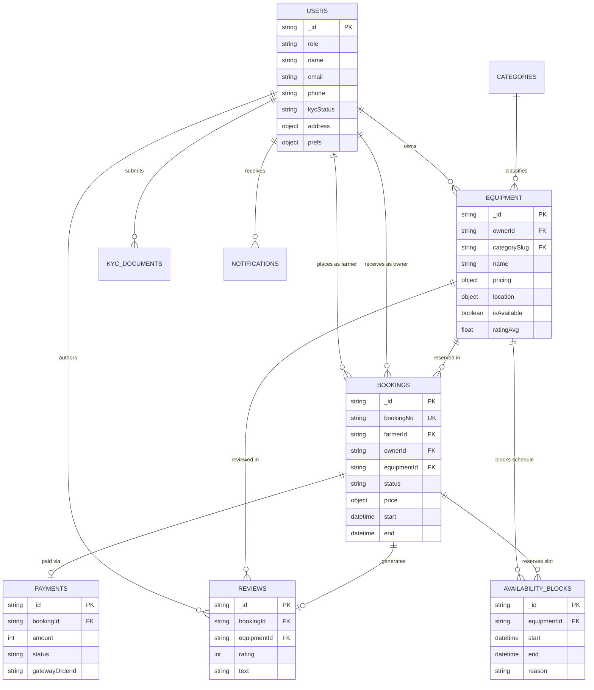
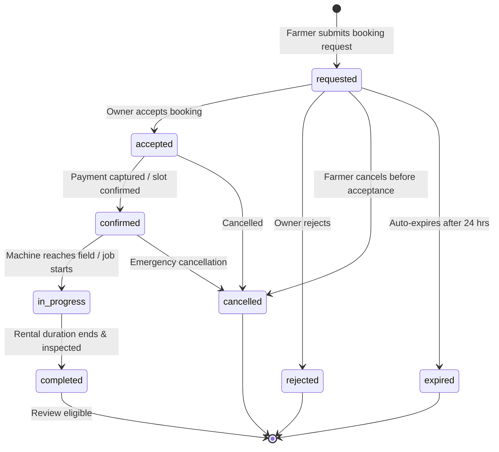

# FarmRentHub Database Architecture & Schema Specification

This document details the MongoDB data layer for the **FarmRentHub** agricultural machinery booking platform.

---

## 1. Entity Relationship Diagram (Mermaid)

---

## 2. Booking Lifecycle State Machine (Mermaid)

---

## 3. Data Dictionary

### 3.1 `users` Collection
| Field | Type | Required | Description / Rules |
| :--- | :--- | :--- | :--- |
| `_id` | ObjectId/str | Yes | Unique User ID |
| `role` | str (Enum) | Yes | `farmer`, `owner`, `admin` |
| `name` | str | Yes | 2-80 chars. Indic script allowed. Rejects 12-digit Aadhaar pattern. |
| `email` | str | Yes | Unique, lowercase. |
| `phone` | str | Yes | Unique, format `+91XXXXXXXXXX`. |
| `address` | object | Yes | `{ country, stateCode, districtCode, blockCode, line, village, pincode }` |
| `kycStatus` | str (Enum) | Yes | `not_submitted`, `pending`, `verified`, `rejected` |
| `prefs` | object | Yes | `{ landUnit, digitStyle, textSize, simpleMode }` |
| `deletedAt` | datetime | No | DPDP soft delete / anonymization timestamp |

### 3.2 `equipment` Collection
| Field | Type | Required | Description / Rules |
| :--- | :--- | :--- | :--- |
| `_id` | ObjectId/str | Yes | Unique Equipment ID |
| `ownerId` | str | Yes | Reference to User ID |
| `categorySlug` | str | Yes | Reference to Category slug |
| `name` | str | Yes | Generic name (e.g. "50 HP Farm Tractor"). No trademarks. |
| `location.exact` | GeoPoint | Yes | **Private**. Only returned to owner & confirmed renter. |
| `location.public` | GeoPoint | Yes | **Public**. Deterministic ~1km privacy jitter. 2dsphere indexed. |
| `pricing` | object | Yes | Rates in integer **paise** (`perHour`, `perDay`, `perAcre`). |
| `searchKeywords` | array[str] | Yes | 12 Indic language synonyms for multi-lingual search. |
| `version` | int | Yes | Optimistic locking counter. |

### 3.3 `bookings` Collection
| Field | Type | Required | Description / Rules |
| :--- | :--- | :--- | :--- |
| `bookingNo` | str | Yes | Unique sequential identifier (`FRH-2026-000001`). |
| `farmerId` | str | Yes | Renter reference |
| `equipmentId` | str | Yes | Machinery reference |
| `start` / `end` | datetime | Yes | Schedule timestamps |
| `price` | object | Yes | Server-side pricing snapshot in paise (`rentalFee`, `platformFee`, `deposit`, `total`). |
| `status` | str (Enum) | Yes | State machine strictly enforced. |

---

## 4. Privacy & DPDP Compliance Rules
1. **Aadhaar Protection:** Any input matching 12 consecutive digits (`\b\d{4}\s?\d{4}\s?\d{4}\b`) is rejected with a 422 error.
2. **Location Isolation:** `location.exact` is never exposed in public queries (`GET /equipment`, `GET /equipment/nearby`).
3. **Right to Erasure / Anonymization:** `POST /users/me/delete-request` replaces personal details with anonymized hashes while keeping statutory audit receipts.
